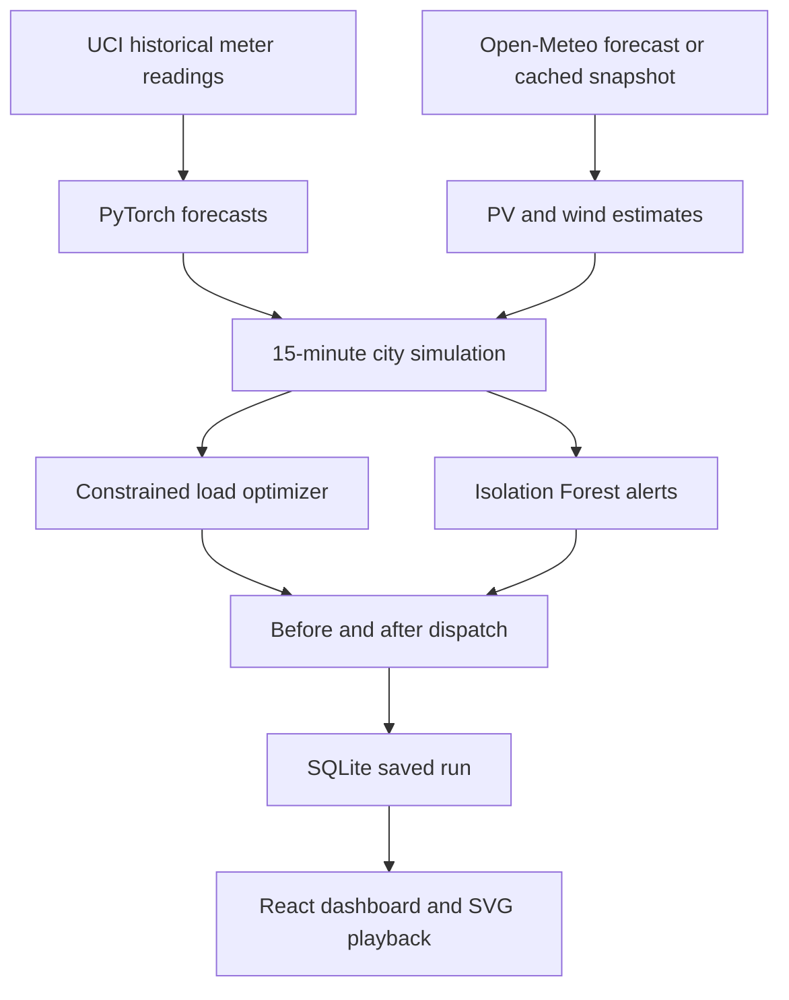

# Architecture and algorithms

## Data flow



The frontend never invents new power values while playing. It advances an index through the backend's calculated series. Changing a scenario runs a new calculation. Applying dispatch persists a flag and selects the solved per-load series. Pausing stops both index advancement and SVG flow/turbine animation. Flow widths and durations depend on delivered power; turbine speed depends on estimated hub wind.

## Native time base and units

- Simulation and optimization always use **15-minute** slots, `dt = 0.25 h`.
- City power is MW. Interval energy is power × 0.25 h, in MWh.
- Original meter readings and model accuracy remain kW.
- Hourly charts average four native predictions. Daily charts average 96 native predictions. They do not re-fit separate hourly/daily models or silently substitute energy for power.
- 24/48/72-hour outputs contain 96/192/288 native slots. Each neural forward pass forecasts the next 96 slots; later blocks consume prior predictions, not future measured data.

## Renewable generation

Weather inputs are Pune hourly temperature, shortwave radiation, and 10m wind speed. Values are held over four slots. Scenario controls scale radiation/wind and offset temperature. Weather provenance identifies retrieval time, forecast date, source, and fallback.

Solar estimate:

`T_cell = T_air + 0.03 × GHI`

`PV = clip(capacity × GHI/1000 × 0.86 × (1 - 0.004 × (T_cell - 25)), 0, capacity)`

Wind speed at an 80m hub is `v80 = v10 × (80/10)^0.14`. Capacity factor is zero below 3 m/s or at/above 25 m/s, follows `(v³ - 3³)/(12³ - 3³)` between 3 and 12 m/s, and is 1 between 12 and 25 m/s.

These are simplified engineering curves. Horizontal irradiance is a proxy for panel-plane irradiance; no actual generation, shading geometry, manufacturer turbine curve or battery is modeled.

## Demand response: transport linear program

For every eligible load `l` and original slot `s`, the optimizer assigns a nonnegative flexible power amount `x[l,s,t]` to an allowed destination `t`.

Hard constraints:

1. `sum_t x[l,s,t] = original flexible power[l,s]` for **every source slot**. This preserves each load's energy and prevents deleting inconvenient demand.
2. Destination slots satisfy operating hours, the source's maximum shift distance, and the same local calendar day.
3. Fixed load plus incoming flexible load cannot exceed the simulated feeder's capacity.
4. Hospital power is fixed at 0.85 MW and never participates in optimization.
5. EV transfers stay in the same connection session: 00–07, 07–17, or 17–24. Charging cannot move before that session's arrival or after its departure.
6. Grid imports cannot exceed the selected import limit. Supply inequalities include a nonnegative, heavily penalized **unserved demand** slack.
7. Optimized peak requested demand cannot exceed the original peak.

| Load | Default flexible share | Maximum displacement | Operating window |
|---|---:|---:|---|
| Residential | 16% | ±1h | 00–24 |
| Commercial | 12% | ±2h | 08–21 |
| Industrial aggregate | 25% | ±2h | 06–23 |
| EV charging | 90% | ±6h | Within connection session |
| Water pumps | 85% | ±8h | 05–23 |
| HVAC aggregate | 25% | ±1h | 07–23 |
| Hospital | 0% | No shifting | Always supplied first |

The global flexibility slider scales these shares. Turning off a participating load makes its entire original schedule fixed. Original consumption outside the flexible operating window also stays fixed.

The objective minimizes imported-energy cost, a peak penalty, small time-displacement penalties, and a large unmet-energy penalty. SciPy HiGHS solves the sparse linear program; a failed solver is an explicit error, not an invented schedule. Peak weight is 1,000 / 20,000 / 100,000 INR per MW per simulated day for cost / balanced / peak priorities. Lost-load penalty is 1,000,000 INR/MWh. These are model assumptions, separate from displayed electricity bills.

The tariff is demonstrative: ₹5/kWh off-peak, ₹8 from 08–17h, ₹12 from 17–22h. Displayed cost equals served grid-import MWh × 1,000 × tariff. Because reducing shortages can increase served energy, savings can be negative. Always compare costs with unserved energy.

## Physical dispatch accounting

For each interval:

```
renewable_used = min(demand, renewable_available)
renewable_gap = max(demand - renewable_available, 0)
grid_import = min(renewable_gap, grid_capacity)
unmet = max(renewable_gap - grid_capacity, 0)
curtailment = max(renewable_available - demand, 0)
```

Thus `demand = renewable_used + grid_import + unmet`. A renewable shortfall alone is **not** called a grid shortage. Grid capacity is included first. When physical supply is insufficient, the hospital is allocated power first, and remaining delivered power is prorated across other loads. Requested energy remains visible and conserved; unserved energy is not claimed as an optimization saving.

## Persistence and API

SQLite uses WAL mode, bound SQL parameters and a connection per operation. `scenarios` stores preset/custom input configurations. `runs` stores complete versioned-by-ID results as JSON, including the dispatch-selection flag. Restoring a run uses its saved numbers rather than recomputing against different weather or model files.

| Route | Action |
|---|---|
| `GET /api/health` | Read artifact readiness. |
| `GET /api/models`, `/api/history`, `/api/backtest` | Read measured data and model evidence. |
| `GET/POST /api/scenarios` | List or save scenario inputs. |
| `DELETE /api/scenarios/{id}` | Remove a custom scenario; presets are protected. |
| `POST /api/simulate` | Validate inputs, forecast, optimize, detect, and save a complete run. |
| `GET /api/runs`, `/api/runs/{id}` | List or restore runs. |
| `POST /api/runs/{id}/dispatch` | Persist original/optimized selection. |
| `GET /api/runs/{id}/export?format=csv|json` | Download time series or complete report. |
| `POST/GET /api/training` | Start a bounded local training job or inspect its actual status/log. |

Training permits one job at a time per backend process. Training writes to a staging directory; publication and simulation inference share a file lock so each simulation uses a consistent model bundle. Individual files are replaced atomically and the registry is published last. Each run records its model version, and the UI prompts for recalculation when a newer version becomes available. Backend shutdown terminates its training child process. The application is intended to run as one local Uvicorn worker. It does not implement a distributed training queue or multi-user authorization.
